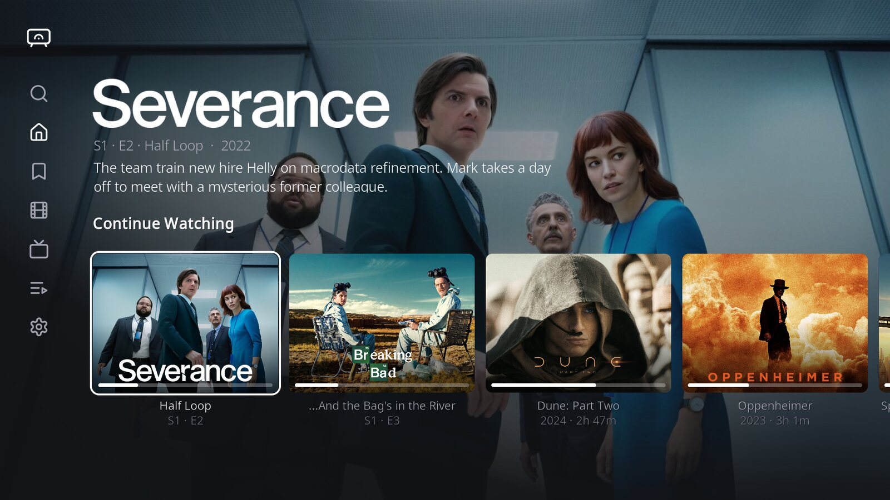
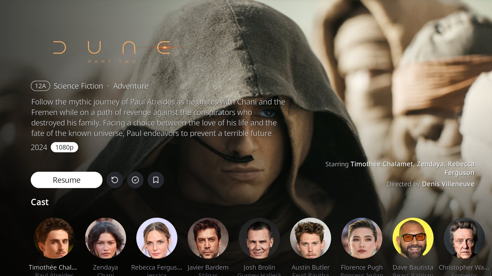
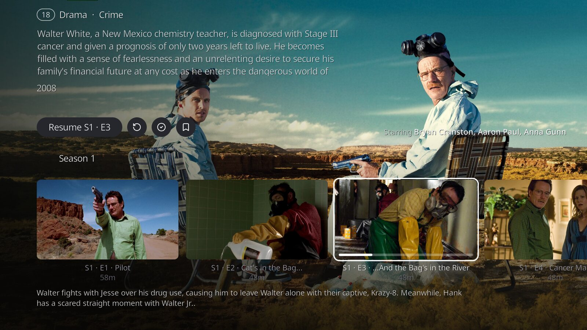
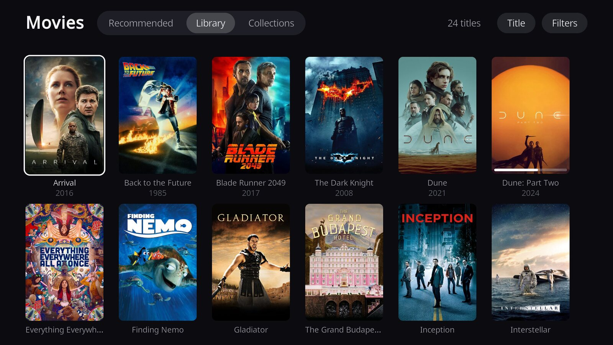
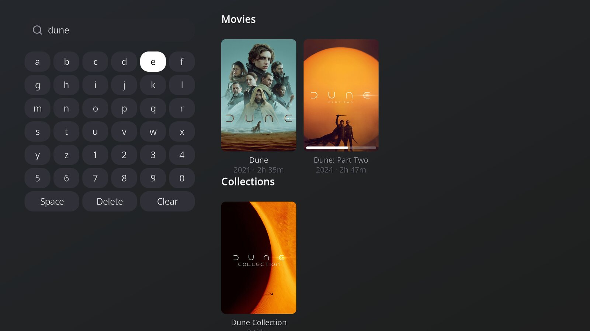
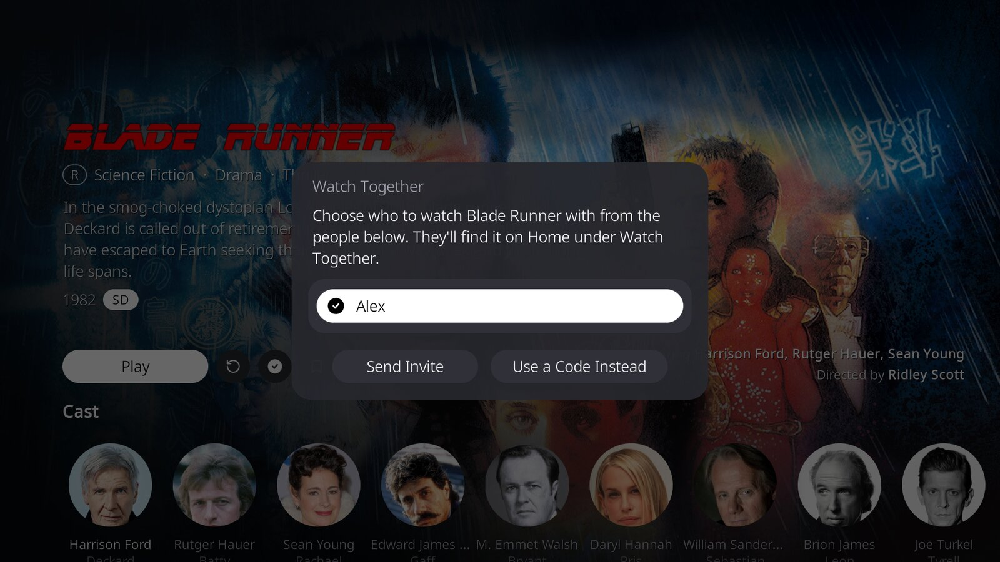
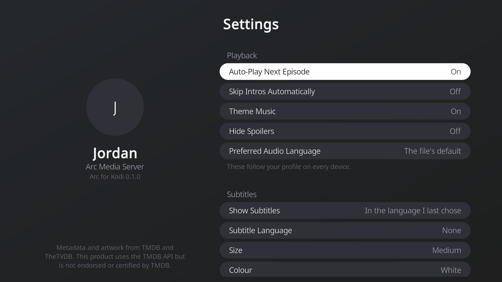
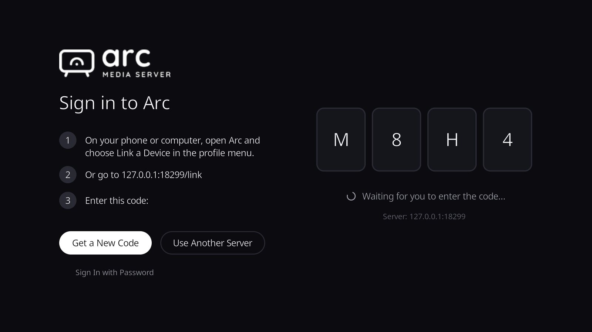
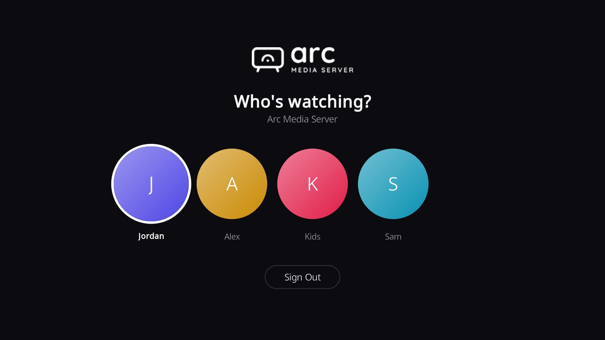

  <picture>
    <source media="(prefers-color-scheme: dark)" srcset="docs/brand/arc-logo-stacked-white.svg">
    
  </picture>

  <strong>Arc for Kodi: your Arc library on the big screen, with Arc's own interface.</strong>

  
  
  
  
  

  

## What is Arc for Kodi?

A full-screen [Kodi](https://kodi.tv) add-on for
[Arc Media Server](https://github.com/arc-media-server/arc-media-server). It draws its own
interface rather than using Kodi's library: Home, your libraries, title pages, search and the
player all look like Arc's other apps, and Kodi's own player plays the video.

Everything comes from your Arc server through its stable `/api/v1`, and your watch history,
resume points and settings are the same as on every other Arc app.

> **Alpha software.** It's in daily use against real servers, but not yet checked on every
> device. Playback, HDR, Dolby Vision and passthrough depend on your Kodi build and hardware.
> See [what's changed](docs/changes/) and the [parity plan](docs/plans/feature-parity.md).

<table>
  <tr>
    <td width="50%"></td>
    <td width="50%"></td>
  </tr>
  <tr>
    <td width="50%"></td>
    <td width="50%"></td>
  </tr>
  <tr>
    <td width="50%"></td>
    <td width="50%"></td>
  </tr>
</table>

## What it does

**🏠 Artwork-led Home.** Continue Watching, Up Next and your libraries' rows, laid out as you
arranged them in Arc, with each title's artwork and logo filling the screen as you move.

**🎬 Title pages in Arc's design.** Play or Resume, Watched and Watchlist; cast, extras,
related titles and collections; seasons and episodes in the order you chose in Arc, including
episodes that order doesn't place. Mark a whole season watched or shuffle it. Pick a version
(4K, a Director's Cut) when a title has more than one.

**📚 Libraries you can browse.** Recommended rows, Browse with Sort and Filter, Collections and
folders for home videos, Play All and Shuffle, and pages for people and collections.

**▶️ Arc's player over Kodi's.** Kodi decodes the video; Arc's controls sit over it: the
timeline with thumbnails and chapters, Skip Intro, Recap and Credits, Up Next, audio and
subtitle tracks, quality, speed and versions, and the episode list. Your progress goes to Arc
as you watch.

**👨‍👩‍👧 Made for a household.** Profiles with PINs, Hide Spoilers, Auto-Play and subtitle
preferences that follow you to every Arc app, and Watch Together: invite people in your
household (or share a code) and the player keeps everyone in step.

**🔐 Signs in with a code.** Enter your server's address, then approve a short code from Arc on
your phone or computer (or use the household password). Your sign-in is kept in the add-on's
own data folder, never in Kodi's settings, a URL or a log.

**📺 Made for a remote.** Focus is always visible, Back always goes back, Context Menu (C or a
long OK) opens a title's actions, and Play on a card plays it. Menus, the keyboard and messages
are Arc's own, not your skin's.

<table>
  <tr>
    <td width="50%"></td>
    <td width="50%"></td>
  </tr>
</table>

## Installing

You need Kodi 19 (Matrix) or newer and an Arc server you can reach from it. Nothing else needs
installing: the add-on uses only Python's standard library, so it runs on Windows, Linux and
LibreELEC, Android and macOS alike.

1. Get the add-on zip: `python3 tools/package.py` writes `dist/script.arc-<version>.zip`.
2. In Kodi, allow unknown sources (**Settings → System → Add-ons**), then choose
   **Add-ons → Install from zip file** and pick the zip.
3. Open **Arc** from your add-ons. Enter your server's address (the one you use for Arc in a
   browser; port 8099 is assumed unless you type another), then open Arc on your phone or
   computer, choose **Link a Device** and enter the code shown.

A Kodi repository, so updates arrive without a zip, is planned.

## Playback

Arc sends original files to Kodi whenever your quality choice and the server's limits allow it.
Kodi's own player and settings handle decoding, HDR and Dolby Vision, tone mapping, audio
passthrough and refresh-rate switching. The add-on doesn't keep
device-specific format rules, and doesn't promise native HDR or Atmos output: what plays, and
how, depends on your Kodi build, hardware and settings.

The add-on's one Kodi setting is the largest picture to ask for (4K, 1080p or 720p). Your
profile's and the server's streaming limits still apply, you can pick a lower quality in the
player, and Arc converts a file Kodi can't play.

Your viewing preferences (Auto-Play, Skip Intros, Hide Spoilers, audio and subtitle languages,
subtitle style) live on the server, in your profile, and are set from Arc's Settings screen.

## For developers

The add-on is two layers:

- `resources/lib/arc/`: plain Python (the API client, Home rows, playback decisions, the
  player's clock and menus), tested with `python3 -m pytest -q` against a stand-in Arc server,
  with no Kodi needed.
- `resources/lib/kodi/`: the Kodi side (windows, the player, the artwork proxy, settings).

Windows are written in `skin/` with shared pieces in `skin/includes.xml`;
`python3 tools/build_skin.py` builds the files Kodi loads (Kodi won't read an add-on's own
includes, colours or fonts). `python3 tools/check.py` checks the skin, the control ids, the
strings and that `arc/` stays free of Kodi. `python3 tools/make_media.py` redraws the skin's
images (needs Pillow, and Node with Playwright's Chromium; development only).

Develop against a scratch Arc, never a real server: `CLAUDE.md` has the details, including how
to run Kodi on a virtual display and drive it from scripts. Each change is described in
[`docs/changes/`](docs/changes/).

## Licence

AGPL-3.0-only, copyright "The Arc Media Server Authors". See [LICENSE](LICENSE). The sidebar's
icons are [Lucide](https://lucide.dev) (ISC; see `resources/LICENSE-lucide.txt`).
